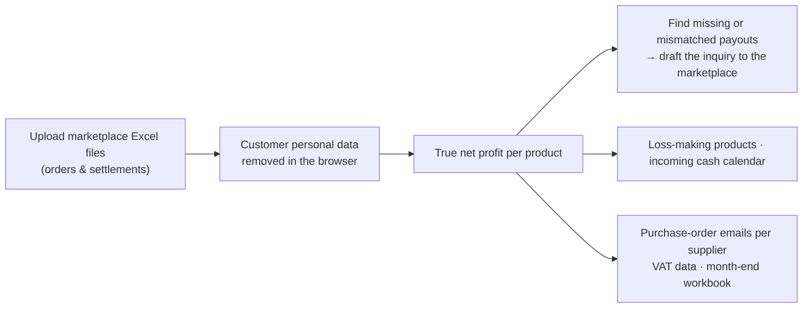

# Sunwook Lee · 이선욱

**An aspiring AI Product Manager who builds to validate** · Second-year Computer Science student

[Portfolio (Notion, Korean)](https://www.notion.so/0b9cebd74e48834eb7ca01a008be2ea4) · [SellerGuard](https://sellerguard.kr) · [developsun04@gmail.com](mailto:developsun04@gmail.com) · [한국어](https://github.com/SUNWOOKLEE04)

I enjoy defining problems, forming hypotheses, validating them through real user behavior, and deciding what comes next. I care less about writing feature specs and more about "what should we build, and why" and "how do we validate and grow it."

My CS background lets me speak the same language as engineers, and when it helps, I build MVPs myself with AI coding agents to test the market.

**What I'm doing now**

- Running **SellerGuard**, a SaaS for online sellers that I planned and built on my own, as an open beta.
- Selling the six textbooks I made as a coding instructor on Kmong, and starting a textbook production service for academies.
- Looking for PM internships and project collaboration.

| Open beta | 13-week experiment | Six textbooks | Grand Prize |
| --- | --- | --- | --- |
| Running SellerGuard solo planning & dev | Hypothesis tested with no development 85.8% positive response (n=28) | On sale on Kmong production service started | Change Maker TR2 design-thinking team project |

## Selected Work

### 01 SellerGuard

One place for online sellers to handle orders, supplier purchase orders, settlements and tax paperwork · [sellerguard.kr](https://sellerguard.kr)

<table>
<tr><th align="left">Role</th><td>Solo planning & development</td></tr>
<tr><th align="left">Period</th><td>2026~ · open beta since November 2026</td></tr>
<tr><th align="left">Status</th><td>Open beta live · paid plans start in January 2027</td></tr>
</table>

  
  

**Problem** · Sellers on Naver Smart Store and Coupang can see revenue right away, but the money actually left after fees, shipping, ads and product cost only shows up after matching spreadsheets by hand. Each marketplace has its own settlement file, so a missing payout goes unnoticed, and supplier purchase orders and VAT paperwork are rebuilt from scratch every time.

**Target & Positioning** · Small, often solo sellers and dropshippers selling on several marketplaces (Smart Store, Coupang, Temu and others). The first promise is one thing: **"not revenue, the money you actually keep."** Purchase orders, settlements and tax work were added behind it.

**Pivot (2026.10)**

> The first plan was competitor price and review monitoring. The official API I planned to use for prices was shut down, and automated collection is blocked by the marketplaces' terms, so I judged the core feature could not last. Based on the pains sellers keep raising in their communities (settlements, cash flow, net profit), I changed direction.

**Key Decisions**

1. **Value before sign-up** · Funnel data showed few sign-ups relative to visits, so I added a no-sign-up tour where visitors use every feature on an example shop's books. Sign-up happens at the moment they want to upload their own file, and Google sign-in is supported
2. **Lower the trust barrier** · No marketplace passwords or API keys; it works from Excel uploads alone. Customer names, phone numbers and addresses are filtered out in the browser and never stored on the server
3. **Content run on data** · I research seller search terms with the official search-trend API to pick blog topics (30+ posts published) and tag each post's link to track visits and sign-ups
4. **Revenue model** · Free plus three subscription tiers (KRW 7,900 / 29,900 / 99,000 per month), split by number of marketplaces, history length, and purchase-order and month-end features. All features are free in the beta through December 2026

**Status & Next**

- Open beta live since November 2026; widening file-format recognition with real seller files
- Funnel being tracked: visits per post → tour → sign-up → first file upload → paid conversion
- Next: automatic import of Coupang orders and settlements; publish conversion and churn after the paid launch

Solution flow and other decisions

 

- **Public data** · Added a page that gathers government support programs sellers can apply for, from the official Bizinfo (기업마당) API, for search traffic and return visits
- **Quality a solo operator can keep up** · Built without an engineering team, using AI coding agents such as Claude Code and Antigravity. About 260 unit tests and browser tests against the live site run on every deploy

### 02 Six Coding Textbooks → Textbook Production for Academies

Web textbooks an instructor can put on screen and teach from right away · [Web sample](https://study-202611.netlify.app)

<table>
<tr><th align="left">Role</th><td>Planning, build & sales</td></tr>
<tr><th align="left">Period</th><td>2026.10~</td></tr>
<tr><th align="left">Status</th><td>Six textbooks on sale on Kmong · landing the first production client</td></tr>
</table>

**Problem** · As a coding instructor, I saw that preparing a subject for the first time, or one outside your major, takes a lot of time, and class quality varies from instructor to instructor.

**What I built** · Six web textbooks (Java for AP CSA, HTML/CSS/JS, Python, C, C++, C#), on sale on Kmong since October 2026. Made with AI coding agents; every example is run to check it.

**Pivot (2026.11)**

> When I pitched academies directly, some wanted textbooks built from their own materials rather than finished ones, and an AP instructor told me the hardest part for academies is writing exam-style problems. I made a **textbook production service** (turning an academy's curriculum and materials into a web textbook) the main offer, kept the six textbooks as examples and Kmong products, and added the AP-style problem set to the sample after that feedback.

**Status & Next** · Sending proposals to academies to land the first client case. I'll review the offer and wording after replies from 30 academies; results will be added here as numbers.

What's in the textbooks, and packaging

 

- Teacher notes, a lesson-by-lesson schedule, student and answer-key worksheets
- Presentation mode that turns each chapter into 16:9 slides automatically; outputs and answers appear one at a time with →, long answers get their own slide
- Scripts that compile and run every example, plus automatic checks for slide overflow and exposed answers
- Java: reflects the 2025-26 AP CSA redesign, with an AP-style problem set (14 multiple choice, 4 FRQ, every answer verified by running the code)

**Quality pass** · The textbooks read as AI-made, so I rewrote all six to a new standard (diagrams, a pre-check quiz, practice that goes predict → fix → order the lines → trace table → write, three-step hints) and moved to a worksheet-style design.

**Packaging** · Kmong: three tiers for an individual instructor, a small academy, and a whole academy. Production service: starts with a pilot of one unit built from the academy's own materials.

### 03 Planfit Case Study

A 13-week behavioral experiment on an asynchronous social feature, run with no development

<table>
<tr><th align="left">Role</th><td>Planning · PHALANX planning club project</td></tr>
<tr><th align="left">Period</th><td>2026 · 13 weeks</td></tr>
<tr><th align="left">Scale</th><td>A small experiment with about 20 participants</td></tr>
<tr><th align="left">Note</th><td>A self-initiated club case study; not affiliated with Planfit.</td></tr>
</table>

**Question** · If the fitness app Planfit entered the US market, what would help users keep working out consistently?

**Hypothesis** · An asynchronous social mechanic that lets users feel each other's workouts without being online together would improve retention.

**Execution**

- Planned async social features driven by user feedback, such as 'Ghost Sync' and 'achievement-rate sync', and published a 5-part series of planning articles
- Designed text-based Ghost Sync logic with no development resources and validated it over 13 weeks via a Wizard-of-Oz MVP
- Pivoted experiment scale from 5 teams → 3 teams (18 users) → 4 teams (20 users), collecting data via KakaoTalk open chats and an auto-aggregating Google Forms/Sheets dashboard

**Results**

| Metric | Result |
| --- | --- |
| Positive response to Ghost Ping | **85.8%** (n=28) |
| Goal-completion rate | **82.5%** |
| Hybrid (home/outdoor) workout verification | **45.2%** |

- Engagement dropped to 40 pts on day 4; after I stepped in manually, it recovered to 70 pts on day 5
- After the challenge, removed mandatory check-ins and opened friend invites so the group could run on its own

**What I learned** · Practiced testing a hypothesis with a behavioral experiment before any development.

## Awards

| Year | Award | Details |
| --- | --- | --- |
| 2026 | **Grand Prize** | Interuniversity Change Maker TR2 · SDG design-thinking team project ['Today-sea'](https://github.com/SUNWOOKLEE04/Today-sea) |
| 2021 | **Future Education Superintendent's Award** | Busan AI Competition · AI camera-based PE attendance system (high school team, planning) |
| 2021 | **Design Excellence Award** | ICT Hackathon · [Intelligent kiosk for visually impaired users](https://github.com/SUNWOOKLEE04/Intelligent-Kiosk-System) (high school team, planning) |
| 2021 | **Prize Winner** | Adaptive sports recommendation system (high school team, planning) |

## Experience

| Period | Activity | Details |
| --- | --- | --- |
| 2026.09~ | GDGoC | Google Developer Groups on Campus member |
| 2026.06~07 | Deep learning & GenAI program | Completed a 160-hour intensive program (AI Grand ICT Research Center) |
| 2025.02~ | Robot Club Coding Club | Coding & robotics instructor · 1:1 and small-group classes, coached a student to USACO |
| 2025~ | PHALANX | Planning club · ran the Planfit case study |
| 2024 | CAHLP · language program · DSAC | Industry-partnered club, CEBU LCIC program (1 month), DSAC M2/M3 certification |

Today-sea · Change Maker TR2 Grand Prize (2026.08)

 

**Overview** · A cross-university exchange program under a university innovation initiative (Aug 10–12, 2026, 3 days/2 nights, Damyang). Ran a team project applying design thinking to real-world issues under the theme of the Sustainable Development Goals (SDGs).

**Problem** · Seafood that is still edible is routinely discarded at scale simply because it doesn't meet market-grade or size standards, while consumers pay inflated prices for fresh seafood due to markups at each layer of the distribution chain.

**Idea** · A direct-trade platform that takes seafood that would otherwise be thrown away straight from fishers and sells it below market price to students and single-person households near campus.

**Activities**

- Design-thinking project: topic selection → empathize (interviewed both fishers and university-district consumers) → define → prototype & user testing → final presentation
- Collaborative workshop exploring SDG messaging through local cultural resources and creative problem-solving
- Team-building and cross-disciplinary collaboration with students from another university

**Result** · As a team, we planned the 'Today-sea' idea, built a prototype, and **won the Grand Prize** at the final presentation.

**Purpose** · To try defining a problem and building a prototype in a short time with students from different majors.

[Repo](https://github.com/SUNWOOKLEE04/Today-sea)

Coding & Robotics Instructor — Robot Club Coding Club (2025.02~)

 

**Overview** · Coding & Robotics Instructor at **Robot Club Coding Club**, a robotics & coding academy, since February 2025 (currently active).

**Activities** · Designed project-based curricula tailored to each student's interests and level, provided 1:1/small-group mentoring, and coached students preparing for competitions.

**Competition Coaching**

- Coached one student all the way to competing in **USACO (USA Computing Olympiad)** / **AI SW Creative Thinking Competition**
- Coaching several other students for coding and robotics competitions at their own level
- Teaching with my own textbooks (see "Six Coding Textbooks → Textbook Production for Academies" above)

**Student Projects I Guided** (built by students, a sample)

| Project | Description | Link |
| --- | --- | :---: |
| AI-Powered Smart Bandage Platform (2025) | QR + web prototype using the Gemini Vision API to assess wound conditions | [Repo](https://github.com/SUNWOOKLEE04/ai-wound-assessment-tool) |
| Collaborative Student Portfolio Platform (2025) | A 10+ page responsive portfolio site built by a 3-person student team | [Repo](https://github.com/SUNWOOKLEE04/student-portfolio) |
| Python RPG Text Game (2025) | A turn-based RPG built to reinforce foundational Python skills | [Repo](https://github.com/Daniel-choi-11/Python-RPG-text-game) |
| BOYNEXTDOOR Lovers Attendance Project (Jun 2026) | A check-in/schedule console app built with an elementary-school student around their favorite idol group, using dictionary-based password/schedule binding, list unpacking, and `.strip()` input guards | [Repo](https://github.com/BBIO-0530/BOYNEXTDOOR-LOVERS-ATTENDANCE-PROJECT) |

※ Some repos live on my account for class management, but all of them are student work.

Building a curriculum around what keeps a student engaged starts from the same place product design does: watching how people behave, not assuming how they will. Sustained since February 2025, alongside coursework and university-transfer preparation.

Deep Learning Fundamentals & Applied Generative AI (2026.06~07)

 

**Overview** · A 160-hour intensive program (8h × 5 days × 4 weeks, Jun 24 – Jul 22, 2026) hosted by the AI Grand ICT Research Center and organized by Busan IT Industry Promotion Agency.

**Curriculum**

- ML/DL fundamentals: data preprocessing, regression/classification/ensembles, MLP/DNN & backpropagation, CNN/RNN/LSTM, and Transformer architecture
- Applied Generative AI: AI agent concepts, prompt design (ROCK framework), Gemini API & Supabase API integration, building applications via vibe coding
- Team project: collaborative build using a generative AI / deep learning theme

**Purpose** · To see firsthand where AI products are technically feasible and where they break down, so my conversations with engineering teams stay grounded in reality.

GDGoC · PHALANX · 2024 activities · 2021 high school projects

 

**GDGoC — Google Developer Groups on Campus (2026.09~)**

- Active since September 2026 in GDGoC, a university developer community that learns and builds projects around Google developer technologies
- Joined to work alongside developers on the same team, deepen my understanding of engineering, and experience firsthand where planning meets development

**PHALANX Planning Club (2025~)**

- The planning club behind the Planfit case study above; active since 2025.

**CAHLP Industry-Partnered Club (2024)**

- Took part in K-ICT Week (BEXCO), connecting with IT companies and seeing B2B business up close
- Built practice apps as club assignments ([toonflix](https://github.com/SUNWOOKLEE04/toonflix), [naver_map_weather](https://github.com/SUNWOOKLEE04/naver_map_weather))

**Language Program & Data/AI Course (2024)**

- CEBU LCIC Program (1 month, summer break) — strengthened English communication through an immersive language program
- DSAC M2/M3 Certification — data science & AI capacity-building program

**High school team projects (2021, planning role)**

| Project | Problem | What I did | Result |
| --- | --- | --- | --- |
| AI Camera-based PE Attendance System | Attendance was hard to check in remote PE classes, and students were less active | Planned a service flow that takes attendance automatically with AI motion recognition, and coordinated the team schedule | **Future Education Superintendent's Award**, Busan AI Competition |
| Intelligent Kiosk for Visually Impaired Users | Visually impaired users struggle to use kiosks on their own | Planned kiosk screens with voice recognition and Braille support, and built a prototype | **Design Excellence Award**, ICT Hackathon · [Repo](https://github.com/SUNWOOKLEE04/Intelligent-Kiosk-System) |
| Adaptive Sports Recommendation System | People with disabilities have trouble finding sports programs that suit them | Planned a recommendation service flow using public data | **Prize Winner** |
| PNU Datathon | — | Took part in a team data analysis project | Participant · [Repo](https://github.com/SUNWOOKLEE04/2021_PNUAC_AIData) |

## Tools

<table>
<tr><th align="left">Use most</th><td>Python, React</td></tr>
<tr><th align="left">Teach & wrote textbooks for</th><td>Java, HTML · CSS · JS, Python, C, C++, C#</td></tr>
<tr><th align="left">AI dev tools</th><td>Claude Code, Antigravity, Gemini API, Hermes Agent</td></tr>
<tr><th align="left">Server & automation</th><td>Ubuntu (Vultr), Docker, Tailscale, n8n</td></tr>
<tr><th align="left">Notes & tracking</th><td>Notion, Google Sheets</td></tr>
</table>

---

Open to PM internships and project collaboration. [developsun04@gmail.com](mailto:developsun04@gmail.com)
