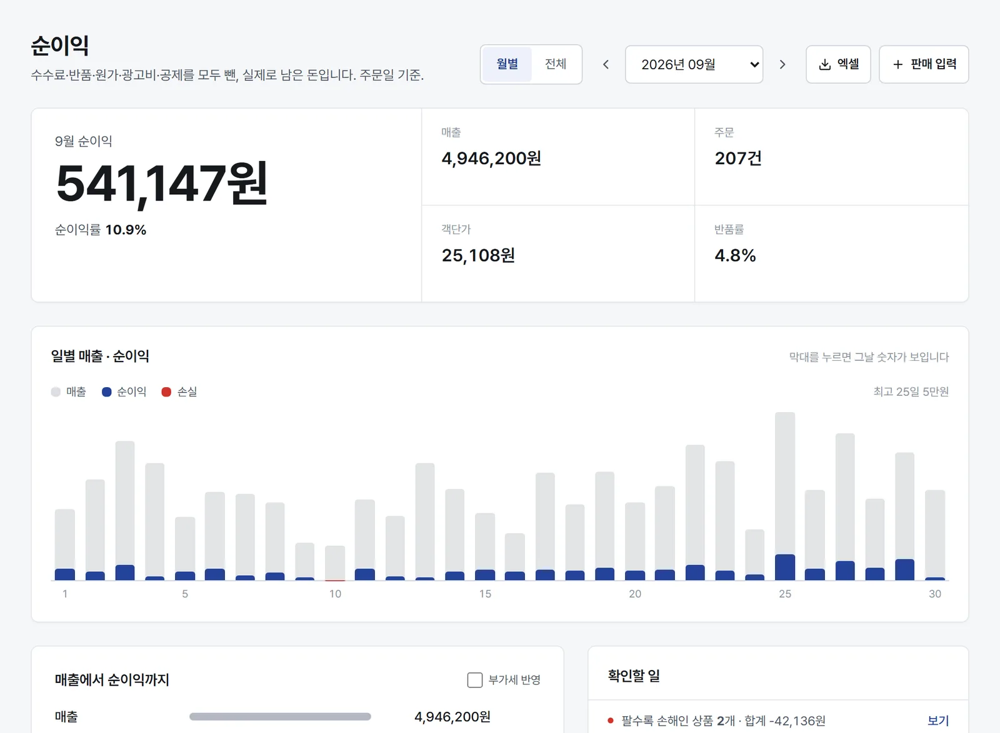
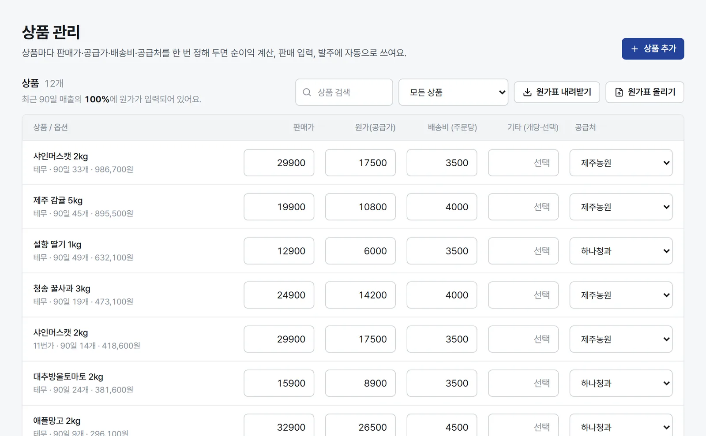
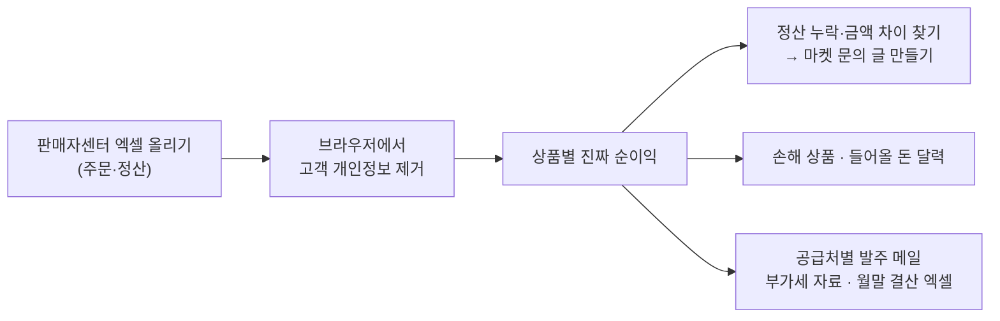

# 이선욱 · Sunwook Lee

**직접 만들어서 검증하는 기획자** · AI 프로덕트 매니저(PM) 지망 · 컴퓨터공학과 2학년

[포트폴리오 (Notion)](https://www.notion.so/0b9cebd74e48834eb7ca01a008be2ea4) · [SellerGuard](https://sellerguard.kr) · [developsun04@gmail.com](mailto:developsun04@gmail.com) · [English](https://github.com/SUNWOOKLEE04/SUNWOOKLEE04/blob/main/README.en.md)

<!-- TODO: 블로그·링크드인이 있으면 위 줄에 같은 형식으로 추가 -->

문제를 정의하고, 가설을 세우고, 사용자 반응으로 검증한 뒤 다음 방향을 정하는 일을 좋아합니다. 기능 명세보다 "무엇을, 왜 만들어야 하는가"와 "어떻게 검증하고 키울 것인가"에 더 관심이 많습니다.

전공 덕분에 개발 흐름을 이해하고 엔지니어와 같은 언어로 이야기할 수 있고, 필요하면 AI 코딩 에이전트로 MVP를 직접 만들어 시장 반응을 확인합니다.

**지금 하는 일**

- 온라인 셀러용 SaaS **SellerGuard**를 혼자 기획·개발해 오픈 베타로 운영하고 있습니다.
- 코딩 강사로 일하며 만든 교재 6종을 크몽에서 판매하고, 학원 교재 제작 대행을 시작했습니다.
- PM·기획 인턴십과 프로젝트 협업 기회를 찾고 있습니다.

| 오픈 베타 | 13주 실험 | 교재 6종 | 대상 |
| --- | --- | --- | --- |
| SellerGuard 운영 1인 기획·개발 | 개발 없이 가설 검증 긍정 반응 85.8% (n=28) | 크몽 판매 중 학원 제작 대행 시작 | Change Maker TR2 디자인씽킹 팀 프로젝트 |

## 대표 작업

### 01 SellerGuard

온라인 셀러가 주문·발주·정산·세금 일을 한 곳에서 하는 SaaS · [sellerguard.kr](https://sellerguard.kr)

<table>
<tr><th align="left">역할</th><td>1인 기획·개발</td></tr>
<tr><th align="left">기간</th><td>2026~ · 2026년 11월 오픈 베타 시작</td></tr>
<tr><th align="left">상태</th><td>오픈 베타 운영 중 · 2027년 1월 유료 전환 예정</td></tr>
</table>

  
  

**문제** · 스마트스토어·쿠팡 셀러는 매출은 바로 보이지만, 수수료·택배비·광고비·원가를 뺀 진짜 남은 돈은 엑셀로 직접 맞춰 봐야 압니다. 마켓마다 정산 파일이 달라서 정산이 빠져도 모르고 지나가고, 공급처 발주서와 부가세 자료도 매번 따로 만듭니다.

**타깃과 포지셔닝** · 스마트스토어·쿠팡·테무 등 여러 마켓에서 혼자 파는 소규모·위탁 셀러. 첫 약속은 **"매출 말고 진짜 남은 돈"** 하나로 잡고, 그 뒤에 발주·정산·세금 일을 붙였습니다.

**피벗 (2026.10)**

> 처음 기획은 경쟁사 가격·리뷰 모니터링이었습니다. 가격 수집에 쓰려던 공식 API가 종료되고 자동 수집은 약관으로 막혀 있어 핵심 기능을 오래 유지할 수 없다고 판단했습니다. 셀러 커뮤니티에서 반복해서 나오는 고민(정산·현금흐름·순이익)을 근거로 방향을 바꿨습니다.

**핵심 의사결정**

1. **가입 전에 가치 확인** · 유입에 비해 가입이 적다는 퍼널 데이터를 보고, 가입 없이 예시 가게 장부로 모든 기능을 써 보는 둘러보기를 추가. 내 파일을 올리는 순간에 가입하도록 설계하고 구글 계정 가입도 지원
2. **신뢰 장벽 낮추기** · 마켓 비밀번호나 API 키를 받지 않고 엑셀 업로드만으로 동작. 고객 이름·연락처·주소는 브라우저에서 걸러 서버에 저장하지 않음
3. **데이터로 콘텐츠 운영** · 공식 검색 트렌드 API로 셀러 검색어를 조사해 블로그 주제를 정하고(30여 편 발행), 글마다 꼬리표 링크를 달아 방문과 가입을 추적
4. **수익 모델** · 무료 + 3단계 구독(월 7,900 · 29,900 · 99,000원). 마켓 수, 기록 기간, 발주·결산 기능으로 구분. 2026년 12월까지 전 기능 무료 베타

**현재와 다음**

- 오픈 베타 운영 중(2026년 11월~). 실제 셀러 파일로 양식 인식을 넓히는 단계
- 추적 중인 퍼널: 글별 유입 → 둘러보기 → 가입 → 첫 파일 업로드 → 유료 전환
- 다음 계획: 쿠팡 주문·정산 자동 불러오기, 유료 전환 후 전환율·이탈률 공개

<!-- TODO 유료 전환 후: 가입자 수, 유료 고객 수, 전환율, 월 이탈률을 여기에 추가 -->

솔루션 흐름과 그 밖의 결정

 

- **공공 데이터 연결** · 기업마당 공식 API로 셀러가 신청할 수 있는 정부·지자체 지원사업을 모아 보여 주는 화면을 추가(검색 유입과 재방문 목적)
- **혼자 운영할 수 있는 품질 관리** · 개발팀 없이 Claude Code·Antigravity 등 AI 코딩 에이전트로 구현. 단위 테스트 260여 개와 실제 사이트 화면 테스트를 배포마다 돌려 확인

### 02 코딩 교재 6종 → 학원 교재 제작 대행

화면에 띄우면 바로 수업할 수 있는 강사용 웹 교재 · [웹 샘플](https://study-202611.netlify.app)

<table>
<tr><th align="left">역할</th><td>기획·제작·영업</td></tr>
<tr><th align="left">기간</th><td>2026.10~</td></tr>
<tr><th align="left">상태</th><td>6종 크몽 판매 중 · 제작 대행 첫 고객 사례를 만드는 단계</td></tr>
</table>

**문제** · 코딩 강사로 일하면서, 처음 맡는 과목이나 전공이 아닌 과목은 수업 준비에 시간이 많이 들고 강사마다 수업 품질이 달라진다는 점을 직접 겪음

**만든 것** · 강사용 웹 교재 6종(자바 AP CSA · HTML/CSS/JS · 파이썬 · C · C++ · C#). 2026년 10월 크몽 판매 시작. AI 코딩 에이전트로 만들고 예제는 전부 실행해서 확인

**피벗 (2026.11)**

> 학원에 직접 제안해 보니 완성 교재보다 "우리 학원 자료로 만든 교재"를 원하는 반응이 있었고, AP 강사에게서 "학원이 가장 힘든 건 시험 유형 문제 만들기"라는 피드백을 받음. 주력을 학원 자료를 웹 교재로 만들어 주는 **제작 대행**으로 바꾸고, 6종은 예시이자 크몽 상품으로 둠. 피드백을 받은 뒤 AP 유형 문제 세트를 만들어 샘플에 추가

**현재와 다음** · 학원 대상 제안을 보내며 첫 고객 사례를 만드는 단계. 30곳의 회신을 모은 뒤 상품과 문구를 다시 판단합니다. 결과는 숫자로 업데이트할 예정입니다.

교재 구성과 판매 설계

 

- 선생님 노트, 차시별 일정표, 학생용 · 정답지 워크시트
- 발표 모드: 장 본문을 16:9 슬라이드로 자동 구성. 실행 결과와 정답은 →로 하나씩, 긴 정답은 다음 장에
- 예제를 실제로 컴파일 · 실행하는 검증 스크립트, 슬라이드 넘침 · 정답 노출 자동 점검
- 자바: 2025-26 AP CSA 개편 반영, AP 유형 문제 세트(객관식 14 · FRQ 4, 모든 코드를 실행해 정답 검증)

**품질 개선** · 교재에서 "AI로 만든 티"가 난다고 판단해 6종을 새 기준으로 다시 씀(그림, 시작 전 진단, 예측 → 고치기 → 순서 맞추기 → 추적표 → 작성 순서의 연습, 3단계 힌트). 디자인도 학습지풍으로 바꿈

**판매 설계** · 크몽: 개인 강사 / 소규모 학원 / 학원 전체 3단계 패키지. 제작 대행: 그 학원 자료로 한 단원을 먼저 만드는 파일럿부터

### 03 플랜핏 케이스 스터디

개발 없이 13주간 운영한 비동기 소셜 기능 행동 실험

<table>
<tr><th align="left">역할</th><td>기획 · PHALANX 기획 동아리 프로젝트</td></tr>
<tr><th align="left">기간</th><td>2026 · 13주</td></tr>
<tr><th align="left">규모</th><td>참여자 20명 안팎의 소규모 실험</td></tr>
<tr><th align="left">참고</th><td>동아리 자체 케이스 스터디이며, 플랜핏 회사와는 관계가 없습니다.</td></tr>
</table>

**질문** · 운동 앱 '플랜핏'이 미국 시장에 진출한다고 가정할 때, 사용자가 운동을 꾸준히 이어가게 하려면 무엇이 필요할까

**가설** · 같은 시간에 함께하지 않아도 서로의 운동을 느끼게 하는 비동기 소셜 장치가 지속률을 높일 것

**실행**

- '고스트 싱크(Ghost Sync)', '달성률 동기화' 등 사용자 반응 기반 비동기 소셜 기능 기획, 5주간 기획 아티클 연재
- 개발 리소스 없이 텍스트 기반 Ghost Sync 로직을 설계하고 Wizard of Oz 방식으로 13주간 직접 검증
- 5팀 → 3팀(18명) → 4팀(20명)으로 실험 규모 피벗, 카카오톡 오픈채팅 + 구글폼/시트 자동 집계로 실사용자 데이터 수집

<!-- TODO: 5편 전략 아티클 링크를 여기에 추가 -->

**결과**

| 지표 | 결과 |
| --- | --- |
| Ghost Ping 긍정 반응 | **85.8%** (n=28) |
| 목표 달성률 | **82.5%** |
| 하이브리드(홈트/야외) 인증 | **45.2%** |

- 4일차에 참여도가 40점까지 떨어진 뒤, 직접 개입해 5일차에 70점으로 회복
- 챌린지 종료 후 강제 인증을 없애고 지인 초대를 열어 자율 커뮤니티로 전환

**배운 점** · 개발에 들어가기 전에 행동 실험으로 가설부터 확인하는 방식을 직접 해봄

## 수상

| 연도 | 수상 | 내용 |
| --- | --- | --- |
| 2026 | **대상** | 학습이룸 Change Maker TR2 · SDGs 디자인씽킹 팀 프로젝트 ['Today-sea'](https://github.com/SUNWOOKLEE04/Today-sea) |
| 2021 | **미래교육감상** | 부산 AI 경진대회 · AI 카메라 기반 체육 출결 시스템 (고교 팀, 기획) |
| 2021 | **디자인 우수상** | ICT 해커톤 · [시각장애인을 위한 지능형 키오스크](https://github.com/SUNWOOKLEE04/Intelligent-Kiosk-System) (고교 팀, 기획) |
| 2021 | **입상** | 장애인 맞춤형 생활체육 추천 시스템 (고교 팀, 기획) |

## 경험

| 기간 | 활동 | 내용 |
| --- | --- | --- |
| 2026.09~ | GDGoC | Google Developer Groups on Campus Member |
| 2026.06~07 | 딥러닝 · 생성형 AI 과정 | 160시간 심화 과정 수료 (인공지능그랜드ICT연구센터 주관) |
| 2025.02~ | 로봇클럽 코딩클럽 | 코딩 · 로보틱스 강사 · 1:1·소그룹 수업, 학생 USACO 출전 코칭 |
| 2025~ | PHALANX | 기획 동아리 · 플랜핏 케이스 스터디 진행 |
| 2024 | CAHLP · 어학연수 · DSAC | 기업 연계 동아리, CEBU LCIC 연수(1개월), DSAC M2/M3 수료 |

Today-sea · Change Maker TR2 대상 (2026.08)

 

**개요** · 대학혁신지원사업 참여 대학 간 교류 프로그램 (2026.8.10~8.12, 2박 3일, 담양). '지속가능발전목표(SDGs)'를 주제로 실제 이슈를 이해하고 디자인씽킹 방법론으로 문제를 해결하는 팀 프로젝트 수행

**문제 정의** · 수산업 현장에서는 상품성이 낮거나 규격에 맞지 않는다는 이유로 아직 먹을 수 있는 수산물이 대량 폐기되는 반면, 소비자는 유통 단계마다 마진이 붙어 신선한 수산물을 상대적으로 비싸게 구매하는 구조적 비효율이 존재함

**아이디어** · 버려질 수산물을 어민에게서 직접 받아, 대학가 자취생 · 1인 가구에게 시세보다 싸게 연결하는 직거래 플랫폼

**활동**

- 디자인씽킹 프로젝트: 경험/주제 선정 → 사용자 공감(어민·대학상권 양측 인터뷰) → 문제 정의 → 프로토타입 & 사용자 테스트 → 결과물 발표
- 지역 문화자원을 활용한 SDGs 메시지 탐색 및 창의적 문제해결 워크숍(협력 체험) 참여
- 타 대학 학생들과의 팀빌딩 및 다학제 간 협업 경험

**결과** · 팀으로 'Today-sea' 아이디어를 기획하고 프로토타입을 만들어 최종 발표에서 **대상** 수상

**참여 목적** · 전공이 다른 학생들과 짧은 기간 안에 문제를 정하고 프로토타입까지 만들어 보기 위해 참여

[Repo](https://github.com/SUNWOOKLEE04/Today-sea)

코딩 · 로보틱스 강사 — 로봇클럽 코딩클럽 (2025.02~)

 

**개요** · 2025년 2월부터 로봇·코딩 교육 학원 **로봇클럽 코딩클럽**에서 코딩·로보틱스 강사로 활동 중 (현재도 진행 중)

**활동** · 학생 개개인의 관심사와 눈높이에 맞춘 프로젝트 기반 커리큘럼 설계, 1:1/소규모 멘토링, 대회 출전 코칭

**대회 준비 지도**

- 학생 1명을 **USACO(미국 컴퓨팅 올림피아드)** / **AI SW 사고력대회** 출전까지 코칭
- 그 외 여러 학생의 코딩 · 로보틱스 대회 준비를 각자 수준에 맞춰 지도
- 직접 만든 교재(위 「코딩 교재 6종 → 학원 교재 제작 대행」)로 수업 진행

**지도한 학생 프로젝트** (학생이 직접 만들고 제가 지도한 작품 중 일부)

| 프로젝트 | 내용 | 링크 |
| --- | --- | :---: |
| AI-Powered Smart Bandage Platform (2025) | Gemini Vision API로 상처 상태를 평가하는 QR+웹 프로토타입 | [Repo](https://github.com/SUNWOOKLEE04/ai-wound-assessment-tool) |
| Collaborative Student Portfolio Platform (2025) | 3인 학생 팀이 만든 10+ 페이지 반응형 포트폴리오 사이트 | [Repo](https://github.com/SUNWOOKLEE04/student-portfolio) |
| Python RPG Text Game (2025) | 파이썬 기초 학습을 위한 턴제 RPG 게임 | [Repo](https://github.com/Daniel-choi-11/Python-RPG-text-game) |
| BOYNEXTDOOR Lovers Attendance Project (2026.06) | 초등학생이 좋아하는 아이돌 그룹을 소재로 함께 만든 출퇴근·스케줄 관리 콘솔 프로그램. 딕셔너리 기반 비밀번호/스케줄 바인딩, 리스트 언패킹, `.strip()` 입력 방어 코드 적용 | [Repo](https://github.com/BBIO-0530/BOYNEXTDOOR-LOVERS-ATTENDANCE-PROJECT) |

※ 일부 레포는 수업 관리를 위해 제 계정에 올려 두었지만, 모두 학생 작품입니다.

각 학생의 흥미를 학습 동기로 바꾸는 커리큘럼을 짜다 보면, 결국 사용자가 실제로 어떻게 움직이는지부터 관찰하게 됩니다. 학업·편입 준비와 병행하면서도 2025년 2월부터 꾸준히 이어온 활동입니다.

원리로 알아가는 딥러닝 기초와 생성형 AI 활용 (2026.06~07)

 

**개요** · 인공지능그랜드ICT연구센터 주관, 부산정보산업진흥원 주최 160시간(8h×5일×4주) 심화 과정 (2026.06.24 ~ 07.22)

**커리큘럼**

- 머신러닝/딥러닝 원리: 데이터 전처리, 회귀·분류·앙상블, MLP·DNN·역전파, CNN/RNN/LSTM, Transformer 구조 이해
- 생성형 AI 실전: AI 에이전트 개념, 프롬프트 설계(ROCK 기반), Gemini API 및 Supabase API 연동, 바이브 코딩으로 애플리케이션 구현
- 팀 프로젝트: 생성형 AI/딥러닝 기반 주제 선정 및 협업 실습

**수강 목적** · AI 제품이 기술적으로 어디까지 가능하고 어디서 한계에 부딪히는지 직접 체감하고, 개발팀과 정교하게 소통하기 위해 수강

GDGoC · PHALANX · 2024년 활동 · 2021년 고교 프로젝트

 

**GDGoC — Google Developer Groups on Campus (2026.09~)**

- 2026년 9월부터 Google 개발자 기술을 중심으로 함께 학습하고 프로젝트를 진행하는 대학생 개발자 커뮤니티 GDGoC에서 활동 중
- 개발자들과 같은 팀에서 일하며 기술 흐름을 더 깊이 이해하고, 기획과 개발이 맞물리는 지점을 직접 경험하기 위해 참여

**PHALANX 기획 동아리 (2025~)**

- 위 플랜핏 케이스 스터디를 진행한 기획 동아리로, 2025년부터 활동 중입니다.

**CAHLP 기업 연계 동아리 (2024)**

- K-ICT Week(BEXCO)에 참여해 IT 기업들과 교류하며 B2B 비즈니스 현장을 경험
- 동아리 과제로 연습용 앱 제작 ([toonflix](https://github.com/SUNWOOKLEE04/toonflix), [naver_map_weather](https://github.com/SUNWOOKLEE04/naver_map_weather))

**어학연수 & 데이터·AI 과정 (2024)**

- CEBU LCIC 연수 (여름방학, 1개월) — 어학연수를 통한 영어 커뮤니케이션 역량 강화
- DSAC M2/M3 수료 — 데이터 사이언스 및 AI 활용 역량 강화 프로그램

**고교 팀 프로젝트 (2021, 기획 담당)**

| 프로젝트 | 문제 | 한 일 | 결과 |
| --- | --- | --- | --- |
| AI 카메라 기반 체육 출결 시스템 | 비대면 체육 수업에서 출결 확인이 어렵고 학생 활동량이 줄어듦 | AI 모션 인식으로 출결을 자동 처리하는 서비스 흐름 기획, 팀 일정 조율 | 부산 AI 경진대회 **미래교육감상** |
| 시각장애인을 위한 지능형 키오스크 | 시각장애인이 키오스크를 혼자 쓰기 어려움 | 음성 인식 · 점자를 지원하는 키오스크 화면 기획과 프로토타입 제작 | ICT 해커톤 **디자인 우수상** · [Repo](https://github.com/SUNWOOKLEE04/Intelligent-Kiosk-System) |
| 장애인 맞춤형 생활체육 추천 시스템 | 장애인이 자신에게 맞는 생활체육 정보를 찾기 어려움 | 공공 데이터를 활용한 맞춤 생활체육 추천 서비스 흐름 기획 | **입상** |
| PNU 데이터톤 | — | 팀 데이터 분석 프로젝트 참여 | 참가 · [Repo](https://github.com/SUNWOOKLEE04/2021_PNUAC_AIData) |

## 도구

<table>
<tr><th align="left">주로 쓰는 것</th><td>Python, React</td></tr>
<tr><th align="left">가르치고 교재로 만든 것</th><td>Java, HTML · CSS · JS, Python, C, C++, C#</td></tr>
<tr><th align="left">AI 개발 도구</th><td>Claude Code, Antigravity, Gemini API, Hermes Agent</td></tr>
<tr><th align="left">서버 · 자동화</th><td>Ubuntu (Vultr), Docker, Tailscale, n8n</td></tr>
<tr><th align="left">기록 · 정리</th><td>Notion, Google Sheets</td></tr>
</table>

---

PM·기획 인턴십과 프로젝트 협업 제안을 기다립니다. [developsun04@gmail.com](mailto:developsun04@gmail.com)
